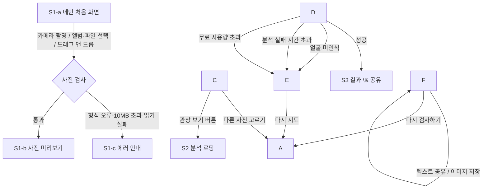

# 🎨 화면 및 사용자 흐름 설계 (03\_UI\_FLOW.md)

이 문서는 사용자가 마주할 화면과 이동 경로(User Flow), 주요 UI 구성요소, 디자인 톤앤매너를 정의하는 문서입니다.

> \*\*상태: 초안 (2026-11-03)\*\*
> 수정: 2026-11-03 — 디자인 톤앤매너(무속·점집 패러디 B급 밈) 확정 반영, 4장 신설
> 기준 문서: `01\_IDEA.md`, `02\_PRD.md` (2026-11-03 승인본)
> 표기 규칙: \*\*`\[가안]`\*\* = 문서에 정해지지 않아 임시로 넣은 것(확정 필요, 5장 질문 목록 참고). 색상·글꼴·버튼 등 시각 디자인 기준은 \*\*4장\*\*에만 적고, 다른 곳에서는 4장을 참고합니다.

\---

## 1\. 전체 화면 구조 (Screen Map)

* 모바일 우선(세로 화면) 설계. PC는 같은 구성을 가운데 정렬된 좁은 폭으로 보여줌. `\[가안]`
* 페이지 이동 없이 한 페이지 안에서 화면이 바뀌는 구조 (결과 링크가 없으므로 주소는 항상 동일).
* 모든 화면 맨 위에 **오방색 띠**를 공통으로 표시 (4.4 참고).

|ID|화면|포함 상태|PRD 근거|
|-|-|-|-|
|S1|메인 \& 업로드|S1-a 처음 / S1-b 사진 미리보기 / S1-c 에러 안내|F-1, 3.1\~3.3|
|S2|분석 로딩|S2-a 로딩 멘트 롤링|F-2, F-3|
|S3|결과 \& 공유|S3-a 결과 / S3-b 공유·저장 완료 알림|F-4, F-5|

\---

## 2\. 사용자 이동 흐름 (User Flow)



**흐름 설명 (한 줄씩)**

1. 메인에서 사진을 넣으면 브라우저가 먼저 형식·용량을 검사합니다. (PRD 3.2)
2. 통과하면 미리보기를 보여주고, 사용자가 버튼을 눌러야 분석이 시작됩니다. (PRD F-1 "업로드 전 프리뷰")
3. 분석 중에는 로딩 화면, 성공하면 결과 화면, 실패하면 메인으로 돌아와 에러 안내를 보여줍니다. `\[가안: 에러를 메인 화면 위에 표시]`
4. 결과 화면에서 공유·저장을 해도 화면은 그대로이고, `\[다시 검사하기]`만 메인으로 돌아갑니다. (PRD F-4)

\---

## 3\. 주요 화면별 와이어프레임 및 설명

> 와이어프레임은 화면 배치만 보여주는 뼈대 그림입니다. 색·글꼴·장식의 구체적인 값은 4장을 따릅니다.
> `( )` = 버튼, `\[ ]` = 입력/영역, `\* \*` = 안내 문구, `{주}` = 주 버튼, `{보}` = 보조 버튼, `{텍}` = 텍스트 버튼 (4.3)

### 3.1 S1 메인 \& 업로드

#### S1-a 처음 화면

```
+------------------------------------
|  ▬▬▬▬▬ 오방색 띠 (청·적·황·백·흑) ▬▬▬▬▬
|
|  ───────────────────────            <- 금색 가는 선
|  킹받는 AI 관상소 (가칭)   \[관상]    <- 점집 현판 제목 + 붉은 도장
|  ───────────────────────
|  \*사진 한 장이면 10초 만에 관상 판독\* \[가안: 소개 문구]
|
|  ┌ \[  사진을 여기에 끌어다 놓으세요  ] ┐ <- 부적 종이 드롭 영역
|  └ \[   (얼굴 일러스트 자리) \[가안]   ] ┘    (주홍 점선 + 금색 꺾쇠)
|
|  {보} ( 📷 카메라로 찍기 )            <- 모바일 카메라 촬영
|  {보} ( 🖼 앨범/파일에서 고르기 )     <- 갤러리·PC 파일 선택
|
|  \*본인 사진 또는 당사자에게 허락받은
|   사진만 올려주세요\*                  <- PRD 3.3
|  \*jpg · png · webp / 10MB 이하\*       <- PRD 3.2
|
|  ---------------------------------
|  \*사진은 저희 서버에 저장되지 않아요.
|   다만 분석을 위해 Google Gemini로
|   전송되며, Google의 정책에 따라
|   처리될 수 있어요.\*                  <- PRD 3.1
|  \*만 18세 이상 이용 가능\*             <- PRD 3.3
|  \*본 결과는 AI가 지어낸 재미용 허구이며,
|   실제 성격·운세와 무관합니다.\*       <- PRD 3.3
+------------------------------------
```

* **주요 구성요소**: 오방색 띠, 현판 제목 + 도장, 소개 문구, 드롭 영역, 카메라 버튼, 파일 선택 버튼, 사진 안내, 하단 고지 3종
* **사용자 행동**: 카메라 촬영 / 파일 선택 / 끌어다 놓기 → 검사 후 S1-b 또는 S1-c
* **참고**: 모바일에서는 드래그 앤 드롭 영역이 사실상 쓰이지 않으므로, 영역을 눌러도 파일 선택이 열리게 함. `\[가안]`
* **연출**: 사진을 끌어다 놓는 중에는 드롭 영역 배경이 부적 황으로 바뀌고 살짝 흔들림 (4.5)

#### S1-b 사진 미리보기

```
+------------------------------------
|  ▬▬▬▬▬ 오방색 띠 ▬▬▬▬▬
|  킹받는 AI 관상소 (가칭)   \[관상]
|
|  \[                                ]
|  \[      (올린 사진 미리보기)       ]
|  \[                                ]
|
|  {주} ( 🔮 관상 보기 )                <- 분석 시작
|  {보} ( 다른 사진 고르기 )            <- S1-a로
|
|  \*본인 사진 또는 당사자에게 허락받은
|   사진만 올려주세요\*
|  ---------------------------------
|  (하단 고지 3종 동일)
+------------------------------------
```

* **사용자 행동**: `\[관상 보기]` → S2로 이동 / `\[다른 사진 고르기]` → S1-a로 복귀
* **처리**: `\[관상 보기]`를 누르는 순간 브라우저에서 사진 축소(긴 변 약 1024px, JPEG) 후 전송 (PRD 3.2)

#### S1-c 에러 안내

```
+------------------------------------
|  +------------------------------     <- 한지 배경 + 주홍 테두리 안내창
|  | (凶)                               <- 주홍 원형 "흉" 도장
|  | (에러 문구)                        <- 아래 표의 문구 중 하나
|  |
|  | {주} ( 다시 시도 )                 <- S1-a로
|  +------------------------------
|
|  (S1-a 화면 내용이 뒤에 그대로 보임) \[가안]
+------------------------------------
```

|상황|표시 문구|PRD 근거|
|-|-|-|
|형식 오류·읽기 실패(HEIC 등)|"이 사진은 너무 고귀한 포맷이라 소인이 읽지 못하옵니다. 카메라로 바로 찍어 주시옵소서!"|3.2|
|10MB 초과|`\[가안]` "사진이 너무 무거워 관상가의 팔이 부러졌습니다. 10MB 이하로 올려주세요!"|3.2 (제한만 있고 문구 없음)|
|얼굴 미인식|"이것은 사람이 아니거나 외계인입니다. 정면 얼굴을 다시 찍어주세요!"|3.2|
|분석 실패·시간 초과|"관상신(神)께서 잠시 자리를 비우셨습니다. 잠시 후 다시 시도해 주세요."|3.2|
|무료 사용량 초과|"오늘 관상소 기운이 모두 소진되었습니다. 내일 다시 찾아주시오."|3.2|

\---

### 3.2 S2 분석 로딩

```
+------------------------------------
|  ▬▬▬▬▬ 오방색 띠 ▬▬▬▬▬
|  킹받는 AI 관상소 (가칭)
|
|      ◜ 오방색 링 회전 ◝
|     (  올린 사진 원형  )  \[가안]
|      ◟               ◞
|
|            🔔  <- 딸랑딸랑 흔들림
|
|  \*『마의상법』 제3권 미간편 대조 중...\*  <- 붓글씨, 먹 번지듯 전환
|
|  \*잠시만 기다려 주시오\* \[가안]
|
|  (화면 가장자리: 촛불빛 은은하게 깜빡임)
+------------------------------------
```

* **주요 구성요소**: 사진 썸네일 + 오방색 회전 링, 방울, 롤링 멘트, 촛불빛 배경
* **로딩 멘트 (PRD F-3 예시 3개 + `\[가안]` 5개, 1.5초 간격 `\[가안]`)**

  1. "『마의상법』 제3권 미간편 대조 중..."
  2. "눈빛 속 숨겨진 흑염룡의 기운 판독 중..."
  3. "조선 팔도 관상가 협회에 자문 요청 중..."
  4. `\[가안]` "천정(天庭)에 깃든 월요병 지수 산출 중..."
  5. `\[가안]` "콧대에 흐르는 재물운의 유속 측정 중..."
  6. `\[가안]` "『상리형진』 각주의 각주까지 뒤지는 중..."
  7. `\[가안]` "입꼬리에 숨은 말실수운 감정 중..."
  8. `\[가안]` "관상가가 안경을 고쳐 쓰는 중..."
* **사용자 행동**: 없음 (기다림). 취소 버튼 없음 — PRD에 정의되지 않음 `\[가안]`
* **이동**: 성공 → S3 / 실패 → S1-c (최대 대기 시간은 성공 지표 기준 10초 이내 목표)

\---

### 3.3 S3 결과 \& 공유

#### S3-a 결과 화면

```
+------------------------------------
|  ▬▬▬▬▬ 오방색 띠 ▬▬▬▬▬
|  +- 이미지 저장 영역 = 부적 카드 ---    <- 이 박스 안만 PNG로 저장 \[가안]
|  | ═════════════════════             <- 금색 가는 선 + 주홍 이중 테두리
|  |  킹받는 AI 관상소 (가칭)           <- 부적 황 배경
|  |
|  |  \[사진 썸네일]
|  |
|  |  「 야근에 영혼 팔린               <- nickname (주홍 붓글씨, 가장 크게)
|  |     방구석 전략가 」   (킹받)      <- 원형 붉은 도장
|  |
|  |  \*천정이 넓으니 『마의상법』에      <- summary (바탕체)
|  |   이르길 회의 시간에 딴생각하는
|  |   자의 상이라.\*
|  |
|  |  ◆ 이마  : (한줄평)               <- features (주홍 마름모 글머리)
|  |  ◆ 눈    : (한줄평)
|  |  ◆ 코    : (한줄평)
|  |  ◆ 입    : (한줄평)
|  |  - - - - - - - - - - -
|  |  🍀 행운의 아이템: 다 식은 믹스커피  <- luckyItem
|  |
|  |  \*본 결과는 AI가 지어낸 재미용
|  |   허구입니다.\*                     <- 면책 (PRD F-4)
|  | ═════════════════════
|  +- 이미지 저장 영역 끝 -----------
|
|  {주} ( 💬 결과 공유하기 )            <- 텍스트 공유 / PC는 복사
|  {보} ( 💾 이미지로 저장 )            <- PNG 저장
|  {텍} ( 🔄 다시 검사하기 )            <- S1-a로
+------------------------------------
```

* **배치 원칙**: 모바일 한 화면 안에 칭호\~행운의 아이템까지 들어오게 함 (PRD F-4 스크린샷 친화). 버튼은 그 아래.
* **부위 개수**: PRD 예시(이마, 눈/눈빛, 코/재물운, 입술/말실수운)를 따라 4개로 그림. `\[가안]`
* **연출**: 카드가 처음 나타날 때 부적이 펼쳐지듯 위에서 아래로 열림 (4.5). 이미지 저장 시에는 애니메이션이 끝난 상태로 저장.
* **사용자 행동**

  * `\[결과 공유하기]`: 휴대폰 공유 창(카카오톡, 메시지 등)을 열거나, 지원하지 않으면 클립보드에 복사 (PRD F-5)
  * `\[이미지로 저장]`: 위 부적 카드 영역을 PNG로 만들어 기기에 저장. 서버로 보내지 않음 (PRD F-5)
  * `\[다시 검사하기]`: 결과를 지우고 S1-a로 (PRD F-4)

**공유 텍스트 형식** `\[가안 — 포함 항목은 PRD F-5 기준]`

```
\[킹받는 AI 관상소] 나의 관상 판독 결과
「야근에 영혼 팔린 방구석 전략가」
천정이 넓으니 ... 자의 상이라.
🍀 행운의 아이템: 다 식은 믹스커피
너도 해보기 👉 (서비스 주소)
```

#### S3-b 공유·저장 완료 알림

```
+------------------------------------
|  (S3-a 화면 그대로)
|
|  +---------------------------+       <- 부적 쪽지 모양 토스트
|  | 결과가 복사되었소! 원하는    |          (부적 황 + 주홍 테두리)
|  | 곳에 붙여넣으시오.          |       <- 클립보드 복사 시 \[가안]
|  +---------------------------+       <- 2\~3초 후 자동으로 사라짐 \[가안]
+------------------------------------
```

* 휴대폰 공유 창이 열리는 경우에는 별도 알림 없음. 이미지 저장은 브라우저 기본 다운로드 표시를 따름. `\[가안]`

\---

## 4\. 디자인 톤앤매너 (2026-11-03 확정)

### 4.1 콘셉트

* **"동네 용한 점집 간판을 패러디한 B급 밈"** — 무당집·점집·부적 분위기를 웃기게 비튼 스타일.
* 그림·일러스트를 추가하기보다 **색감, 글꼴, 버튼, 테두리, 작은 애니메이션**으로 분위기를 만든다.
* 무섭거나 진지한 공포 느낌이 아니라, 가볍게 웃을 수 있는 느낌을 유지한다.

### 4.2 색상 (오방색 + 한지 + 부적)

|이름|용도|라이트|다크 ("한밤의 굿판")|
|-|-|-|-|
|배경 (한지)|페이지 배경|`#F3E9D7`|`#15110E`|
|먹|기본 글자|`#1E1A16`|`#F1E6D2`|
|주홍 (단청 적)|주 버튼, 강조, 도장|`#B5302A`|`#D9483E`|
|부적 황|결과 카드 배경|`#F2CC5B`|`#3A2F12`|
|금테|버튼·카드 테두리 장식|`#C9972E`|`#E2B24A`|
|청|보조 강조|`#2C4A7A`|`#6F93CF`|
|녹|보조 강조|`#3C7A58`|`#6DB38C`|

* 한지 배경에는 아주 옅은 종이 질감만 CSS로 넣고, 이미지 파일은 쓰지 않는다.
* 글자와 배경의 명암 대비는 WCAG AA 이상.

### 4.3 글꼴 (Google Fonts 무료 글꼴만 — PRD 3.5 0원 원칙)

|용도|글꼴|느낌|
|-|-|-|
|제목, 칭호(nickname), 로딩 멘트|Nanum Brush Script|붓글씨|
|한줄평(summary), 부위별 관상평|Gowun Batang|고문헌 바탕체|
|안내, 고지, 버튼 등 나머지|Noto Sans KR|가독성 우선|

### 4.4 버튼 및 공통 요소

|종류|적용 대상|스타일|
|-|-|-|
|`{주}` 주 버튼|관상 보기, 결과 공유하기, 다시 시도|주홍 배경 + 한지색 글자 + **금테 이중 테두리**(현판·부적 느낌), 모서리 4px 내외, 누르면 살짝 눌림, 올리면 금테가 은은하게 빛남|
|`{보}` 보조 버튼|카메라로 찍기, 앨범/파일에서 고르기, 이미지로 저장, 다른 사진 고르기|한지 배경 + 먹색 2px 테두리 + 먹색 글자, 누르면 부적 황 배경|
|`{텍}` 텍스트 버튼|다시 검사하기|테두리 없음, 먹색 밑줄|
|오방색 띠|모든 화면 맨 위|청·적·황·백·흑 순서 얇은 가로 줄무늬 (높이 6\~8px)|
|붉은 도장|제목 옆, 결과 칭호 옆, 에러 안내창|CSS로 그린 주홍 도장, 살짝 기울임. 글자: 제목 "관상" `\[가안]` / 결과 "킹받" `\[가안]` / 에러 "흉(凶)" `\[가안]`|

* 모든 버튼 높이 48px 이상.

### 4.5 애니메이션

|위치|연출|
|-|-|
|S1 드롭 영역|사진을 끌어다 놓는 중 배경이 부적 황으로 바뀌고 살짝 흔들림|
|S2 로딩|사진 둘레 오방색 링 회전, 🔔 방울 흔들림, 멘트가 먹 번지듯 전환, 가장자리 촛불빛 깜빡임|
|S3 결과 카드|부적이 펼쳐지듯 위에서 아래로 열림 (약 0.6초)|

* 기기의 "움직임 줄이기" 설정(`prefers-reduced-motion`)이 켜져 있으면 모든 애니메이션을 끈다.

### 4.6 금지 및 주의

* 장식은 4장에 적힌 것만 넣고, 글을 읽는 데 방해되면 줄인다.
* 귀신·해골 같은 공포 요소, 실제 종교 상징(만자 卍, 십자가 등)은 넣지 않는다.
* 무속은 **패러디 소재**로만 쓰고, 실제 무속 신앙을 비하하는 표현은 쓰지 않는다. (콘텐츠 기준은 PRD 3.4)
* 결과 이미지 저장 시 붓글씨·바탕체가 PNG에도 그대로 나와야 한다 (글꼴 로딩 완료 후 저장).
* 다크모드에서도 같은 분위기("한밤의 굿판")를 유지한다.

\---

## 5\. 질문 및 미정 사항 (Q\&A)

> 아래는 와이어프레임에 `\[가안]`으로 임시 반영된 항목입니다. 답변 후 확정 표시합니다.
> 참고: v0 1차·2차 프롬프트(`temp.md`)에는 아래 `\[가안]` 값이 임시 기본값으로 들어가 있습니다.

**화면 구성**

* \[ ] Q1. 서비스명을 "킹받는 AI 관상소"로 확정할까요?
* \[ ] Q2. 메인 소개 문구와 얼굴 일러스트 자리를 넣을까요? (넣는다면 문구 가안: "사진 한 장이면 10초 만에 관상 판독")
* \[ ] Q3. 사진 동의를 **안내 문구로만** 둘까요, \*\*체크박스(체크해야 버튼 활성화)\*\*로 할까요? (PRD는 "안내"로만 정의)
* \[ ] Q4. 에러를 메인 화면 위 안내창으로 띄우는 방식이 괜찮을까요?

**로딩 화면**

* \[ ] Q5. 로딩 화면에 올린 사진을 작게 보여줄까요?
* \[ ] Q6. 로딩 멘트를 몇 개 만들고, 몇 초마다 바꿀까요? (가안: 8개, 1.5초 간격)

**결과 화면**

* \[ ] Q7. 부위별 관상평은 4개(이마·눈·코·입)로 고정할까요?
* \[ ] Q8. 저장되는 이미지에 **사용자 사진을 포함**할까요? (포함하면 더 재밌지만, 공유 시 얼굴이 함께 퍼짐)
* \[ ] Q9. 공유 텍스트 형식(3.3의 예시)이 괜찮을까요?
* \[ ] Q10. 10MB 초과 에러 문구, 복사 완료 알림 문구를 가안대로 쓸까요?

**디자인**

* \[x] Q11. 시각 디자인 → **무속·점집 패러디 B급 밈 톤** (오방색·한지·부적·붓글씨, 4장) *(2026-11-03 확정)*
* \[ ] Q12. 버튼 이름도 무속 톤으로 바꿀까요? (예: "관상 보기" → "점괘 받기", "다시 검사하기" → "부정 타기 전에 다시 보기") 현재는 기존 이름 유지.
* \[ ] Q13. 도장 글자("관상", "킹받", "흉(凶)")를 가안대로 쓸까요?

